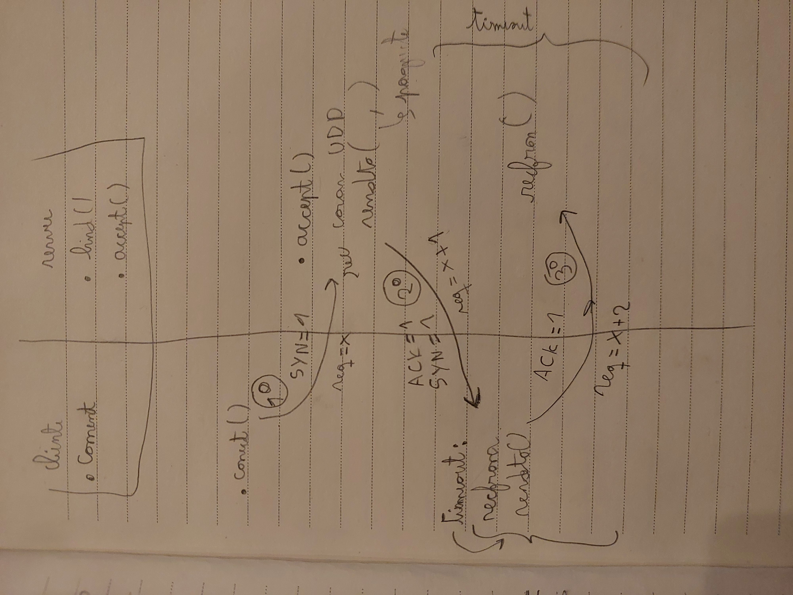
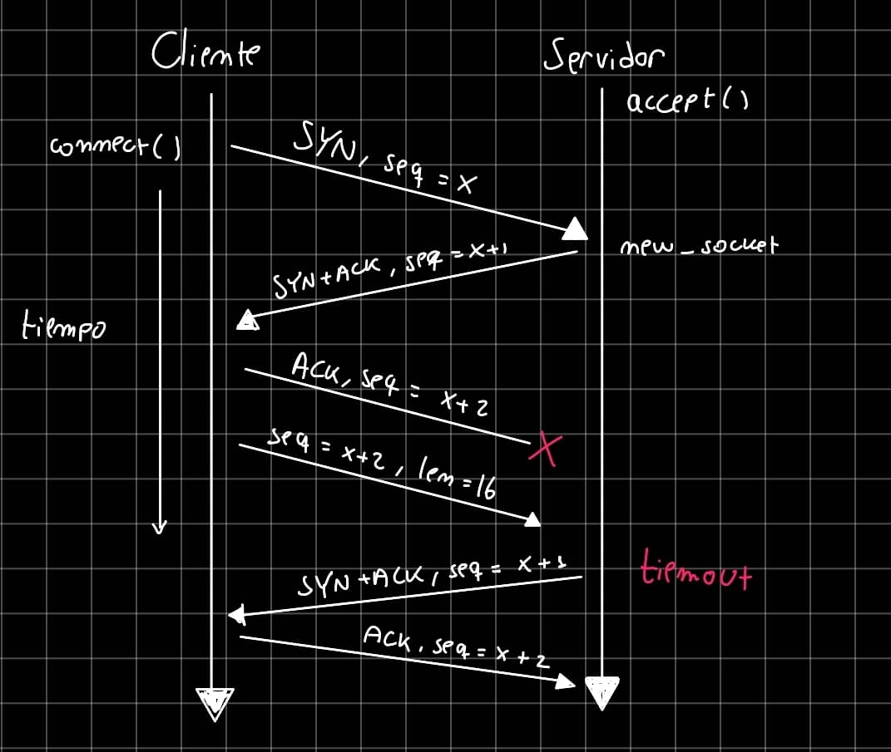

# Actividad 3: SocketTCP con Stop & Wait

- Héctor Bonilla
- Lázaro Narváez 

## Ejecución

Desde la raíz del proyecto, ejecutar en una terminal de Linux:

```bash
python3 servidor.py
```

En otra terminal, enviar el archivo:

```bash
python3 cliente.py localhost 8000 < archivo.txt
```

Para observar el debug, añadir `--debug` al servidor y, en el cliente, después del puerto y antes de `< archivo.txt`.

Requiere Python 3.11 o superior, sin dependencias externas. El cliente recibe host y puerto por consola y el contenido del archivo por entrada estándar. Usa `send()` y `close()`; el servidor reconstruye el archivo con `recv(16)`, que procesa el FIN mediante `recv_close()`.

## Flujo y decisiones de diseño

1. `bind` asocia el socket UDP. Si el cliente no hizo bind, `connect` asigna un puerto disponible.
2. `connect/accept` realizan el handshake. El servidor crea otro socket en un puerto disponible para la conexión.
3. `send` transmite primero la longitud en 4 bytes y después bloques de hasta 16 bytes. Espera el ACK de cada segmento; si vence el timeout fijo de 10 ms, lo retransmite.
4. `recv(n)` confirma duplicados sin repetir datos y guarda los excedentes en un buffer para próximas llamadas.
5. El cierre usa FIN → FIN-ACK → ACK. Se permiten tres timeouts; el emisor repite el ACK final tres veces, separadas por un timeout.

El encabezado contiene ACK, SYN y FIN de 1 byte cada uno, más SEQ de 4 bytes, en orden big-endian: 7 bytes de encabezado y hasta 16 de contenido. El buffer UDP es de 23 bytes. La secuencia avanza una unidad por segmento confirmado, no por byte.

### Decisiones de diseño

- **Encabezado fijo de 7 bytes y enteros big-endian:** simplifica la separación de campos y asegura la misma interpretación en ambos extremos.
- **Longitud en un segmento inicial de 4 bytes:** permite identificar el fin del mensaje sin usar un marcador que pueda confundirse con el contenido.
- **Un segmento pendiente y secuencia por segmento:** simplifica Stop & Wait. Cada ACK confirma una secuencia; los duplicados se confirman nuevamente sin repetir sus datos.
- **Buffer interno para los excedentes:** permite que `recv(n)` entregue como máximo `n` bytes sin perder el resto, incluso cuando `n` no es múltiplo de 16. El buffer UDP se mantiene independiente en 23 bytes para recibir segmentos completos.
- **Timeout fijo de 10 ms:** mantiene simple la implementación y se orienta a localhost; con mayor retardo puede provocar retransmisiones innecesarias. El cierre limita la espera a tres timeouts según el enunciado.
- **Puerto distinto para la conexión aceptada:** separa la transferencia del socket de escucha; el cliente conoce el nuevo puerto mediante el SYN-ACK.

### Diagrama del handshake



### Pérdida del último ACK



`send` reconoce el SYN-ACK repetido y reenvía el ACK final. Como alternativa, si llega primero el segmento de longitud con secuencia x+2, `accept` lo considera confirmación y lo guarda para `recv`.

## Pruebas y resultados

El modo `--debug` muestra envíos, ACK, timeouts, retransmisiones y cierre; se desactiva omitiendo esa opción.

En Ubuntu pasaron las tres pruebas originales, el cierre de ambos sockets y el cierre tras tres timeouts sin respuesta. Se verificó un archivo de 383 bytes sin pérdidas y la reconstrucción exacta de 38 bytes mediante dos llamadas a `recv(19)`, cada una devolviendo 19 bytes.

Con `netem` al 20% de pérdidas, el debug mostró timeouts y retransmisiones. Siete ejecuciones iniciales terminaron correctamente y otra dejó al servidor esperando. Al repetir el diagnóstico, otras quince ejecuciones pasaron y el caso se reprodujo: el cliente agotó sus tres envíos de FIN sin que el servidor recibiera ninguno.

Caso borde del cierre: si se pierden los tres FIN, el cliente cierra tras tres timeouts, pero el servidor sigue esperando el primer FIN. El paso 8 garantiza el cierre del receptor una vez recibido un FIN; no especifica un límite de espera previo. Se conserva este comportamiento para no interrumpir recepciones válidas.

Caso borde: el buffer conserva los bytes sobrantes cuando n no es múltiplo de 16. El timeout de 10 ms puede causar retransmisiones innecesarias en redes con mayor retardo.

## Declaración de IA

- Se usó la IA para poder saber manipular bytes en Python.
- Se usó IA para ajustar la recepción de argumentos por consola en el cliente.
- Se usó IA para destrabar errores durante las pruebas y analizar sus causas.

Se utilizó `sys` porque permite acceder a los argumentos y a la entrada estándar: `sys.argv[1]` obtiene el host, `int(sys.argv[2])` obtiene el puerto y `sys.stdin.buffer.read()` lee los bytes del archivo redirigido con `< archivo.txt`.


